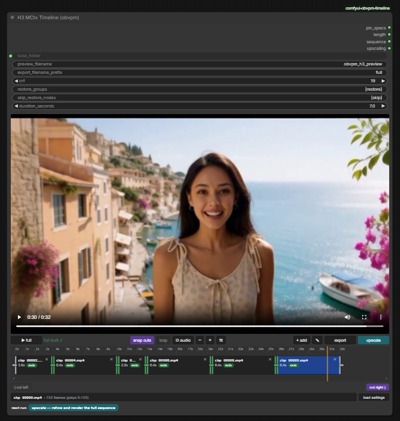

# Magik Timeline (comfyui-magik-timeline)

A MiniMax H3 ComfyUI workflow and nodes that allow generating, extending,
prepending, bridging and editing videos in an easy to use UI.

The timeline node is like a mini video editor.

And it also supports creating seamless looping videos.



## Provenance

Magik Timeline is a port of
[comfyui-obvpm-timeline](https://github.com/chanon/comfyui-obvpm-timeline)
**v0.1.4** by chanon (GPL-3.0), carrying the same node behaviour, file
formats and wire types, under the Magik identity. What changed and what
deliberately did not is mapped in [docs/MAGIK_PORT.md](docs/MAGIK_PORT.md):

- Node class names are prefixed `MAGIK_H3…` so both packs can be installed
  side by side; display names are suffixed `(magik)`.
- Wire types (`OBVPM_H3_*`), the `mctx_v1` sidecar format and the
  `obvpm_cond_v1` format are byte-identical to upstream: clips, sidecars
  and wires move between the two packs freely, and rollback is a class-name
  remap away.
- Saved upstream workflows need the one-time class-name remap: run
  `python migrate_workflows.py workflow.json` (ships with the pack, stdlib
  only, idempotent, `--reverse` for rollback). See `docs/MAGIK_PORT.md` §3.
- The Magik roadmap extends the ported stack with dual-resolution (HR/LR)
  pin work: low-resolution pins are explicit pixel-grade encodings (Path C,
  re-encoded from the clip's MP4 through the existing `_prepare_pixel_pin`
  route), never latent resamples. **Shipped in 0.3.0** as dual-resolution
  mode: H3 MCtx Apply Pins with `two_stage` on, then H3 MCtx Apply Pins
  Stage 2 on the upscaled latent; one window feeds both stages — the exact sidecar slice at the stage-2 resolution,
  the pixel-grade re-encode at stage 1, one shared audio slice, per-stage
  conditioning and masks. See the Phase 1 audit report for the boundary
  decision (rules R1–R7) and `docs/h3-nodes.md` for the node.
- **0.3.1** adds the Phase 4 acceptance-experiment harness
  (`phase4_protocol.py` / `phase4_synthetic.py` / `phase4_run.py`, the
  runbook in `docs/MAGIK_PHASE4_ACCEPTANCE.md`) — the runnable form of the
  audit's boundary condition, deciding by experiment whether Path C holds
  or a `latent-resample` grade (Path B) must be built.
- **0.4.0** closes the roadmap with the one-time workflow migration script
  (`migrate_workflows.py`) and the finalized full regression suite
  (313 unittest tests + 5 frontend `.mjs` scripts).

Thanks to chanon and the upstream community — the upstream tutorial video
([YouTube](https://youtu.be/kqP09NfJXaQ)) remains the best introduction to
the workflow; everything it shows applies to this pack.

## Features

The main node is the **Timeline** node: the clips you generate are placed on it, and it is where you arrange, cut and preview them, and pick which clip the next generation continues from.

Generate a clip, see if you like it, add it to the timeline, then extend from it. Any part you don't like can be redone later.

Every generated clip is saved together with a motion context file (`.mctx`) that holds its latents. Extensions continue from those original latents using latent masks, not from re-encoded pixels, so there are no lighting changes or flickers at the joins. And because the files sit next to the clips, a clip can still be extended at full quality days or months later.

**Generating**

- **Extend** a clip seamlessly.
- **Prepend**: generate what happens *before* a clip
- **Bridge**: generate what happens between the end of one clip and the beginning of another. This lets you redo any section of the video, and bridging onto a fresh generation brings the quality back if it has drifted.
- **Loop**: bridge the last clip back to the first clip to make a seamless looping video.
- **Extend from a cut**: if a clip ends badly, cut off the bad part and extend from the good part. Snap cuts keeps cuts on the latent frame grid.
- Clips that have no motion context (external clips, clips from other workflows) can be extended too, with seam improvements applied automatically.
- **Result preview**: plays each new clip joined to its neighbours and rates how seamless the join is. From there you add it to the timeline, delete it or dismiss it.
- **Live preview**: the H3 Live Preview node shows the sampler's picture in the result preview while it samples, the whole clip on the take's timeline under the preview's own player bar. Lets you quickly see if a generation is going wrong.

**Timeline**

- **Mini Video Editor**: Drag in clips from anywhere, reorder them by dragging, trim the ends, cut left / cut right at the playhead, undo cuts, and open gaps.
- **Quick preview**: plays through the clips right away. **Full preview** assembles them into a single video file, losslessly where possible. **Export** saves the finished video.
- **Load Settings, Prompts from Clips**: restores the prompt, seed, settings and references that a clip was generated with, so you don't have to keep track of them yourself.
- **Swap takes**: Swap between previous takes generated for the same extension, so you can go back to them and swap between them on the timeline.
- The sequence is also available as text, for copying a timeline into another workflow.

**Upscaling**

- A latent upscale and refine of the **whole sequence in one pass**, so details stay consistent across the joins and the result is still seamless.
- Sampling is done in windows, so long or high resolution videos still fit in VRAM.
- Generate at low resolution for fast iteration, then upscale once at the end. This is optional, you can also generate the first pass at final quality.
- Each clip's conditioning is saved with it, so the upscale uses the same references the clip was generated with.

## Dependencies

**ComfyUI 0.35.0 (2026-09-09) or newer is needed:** the workflow's Model Optimization uses core's `Model Sparse Attention` node, which arrived there.

The workflows use these custom node packs, so install all of them:

| Custom node pack                                                                                       | Used for                                                                                  |
| ------------------------------------------------------------------------------------------------------ | ----------------------------------------------------------------------------------------- |
| comfyui-magik-timeline (this pack)                                                                     | The Timeline node, pins, joint render, upscale pass, result preview                       |
| [comfyui-obvpm](https://github.com/chanon/comfyui-obvpm) (0.2.9 or newer)                              | Bundles, Settings Presets, switches and gates, Load Images & Compose, Compatibility Check |
| [ComfyUI-KJNodes](https://github.com/kijai/ComfyUI-KJNodes)                                            | Set / Get nodes, Sage attention patch                                                     |
| [Comfyui_Minimax_h3_latent_Upscaler](https://github.com/LBH-123-AI/Comfyui_Minimax_h3_latent_Upscaler) | The latent upscaler used by the upscale pass                                              |
| [ComfyUI-MiniMax-H3-Turbo](https://github.com/Larryvrh/ComfyUI-MiniMax-H3-Turbo)                       | Turbo LoRA loader for larryvrh turbo                                                      |
| [ComfyUI-Spectrum-MiniMax-H3](https://github.com/xmarre/ComfyUI-Spectrum-MiniMax-H3)                   | Spectrum acceleration                                                                     |
| [rgthree-comfy](https://github.com/rgthree/rgthree-comfy)                                              | Power Lora Loader                                                                         |

### IMPORTANT Compatibility Warnings

These carry over from upstream unchanged — they are about *other* packs and
how they interact with H3 sampling, which this pack relies on:

**Latent upscaler: use the original pack, not the "Plus" fork.** The workflow was built with [LBH-123-AI/Comfyui_Minimax_h3_latent_Upscaler](https://github.com/LBH-123-AI/Comfyui_Minimax_h3_latent_Upscaler). The fork [xmarre/Comfyui_Minimax_h3_latent_Upscaler-Plus](https://github.com/xmarre/Comfyui_Minimax_h3_latent_Upscaler-Plus) registers a node with the **same id and name** but a different set of widgets. Only one of the two can be installed at a time, and with the fork installed the workflow loads wrong:

- **Symptom:** on the *H3 Latent Upscaler 3D* node, `device` shows `true` and `precision` shows `cuda`, and the run fails until both are set by hand.
- **Cause:** the fork removed the `enable_temporal_chunking` and `force_unload` widgets, so every saved value after `align` lands one field too far along.
- **Why not just fix the two fields:** the fork also removed **temporal chunking**, and the upscale pass relies on it. Without it the upscaler normalises over the whole sequence at once, which on longer timelines produces the drifting, hallucinated detail this workflow was tuned to avoid.

If you see the symptom, uninstall the Plus fork, install the original pack, restart ComfyUI and reload the workflow.

**"MiniMax H3 Video Extend (Backported)" causes colour shifts at the joins.** The pack [kat3ri/ComfyUI-MiniMax-H3-Extend](https://github.com/kat3ri/ComfyUI-MiniMax-H3-Extend) (nodes *MiniMax H3 Video Extend (Backported)* and *MiniMax H3 Encode AV (Patched)*) does not just add nodes: at import time it **replaces** two core ComfyUI functions, `MiniMaxH3.extra_conds` and `PackedLayout.__init__`, with copies taken from an older ComfyUI. Those copies affect every H3 sampling run in the session, even in workflows that never use its nodes.

- **Symptom:** an extension's colours and brightness drift away from the clip it continues, or the join has a visible colour/brightness step, even though the timeline's own extensions are normally seamless.
- **Cause:** this pack extends through latent masks. Current ComfyUI passes those masks into the model as per-token denoise masks, so the preserved context frames are run at the clean-conditioning timestep. The replaced `extra_conds` predates that mechanism and silently drops the masks, so the model treats the preserved frames as if they were fully noised and re-renders the continuation against context it cannot see properly. The replaced `PackedLayout` also rejects interior keyframe anchors, which the pin nodes need.
- **Detection:** the mctx pin nodes stop with an error naming the foreign patch. Plain extends do not: they run and simply look wrong.

If you have this pack installed, remove it, restart ComfyUI and re-run the extension. The related [pmhaidn/ComfyUI-Minimax-H3-Extender](https://github.com/pmhaidn/ComfyUI-Minimax-H3-Extender) *wraps* the core function instead of replacing it and leaves the current layout code alone, so it has not shown this problem; it does patch the Turbo LoRA loader, so if you see odd Turbo behaviour with it installed, try without it.

## Installation

Clone (or copy) this folder into `ComfyUI/custom_nodes`:

```
cd ComfyUI/custom_nodes
git clone <magik-timeline repository>
```

Restart ComfyUI. No extra Python dependencies are required.

If you want upstream and Magik installed side by side, both can live in
`custom_nodes` at once — the class names, routes and loggers do not
collide (see [docs/MAGIK_PORT.md](docs/MAGIK_PORT.md)).

## Workflow

Example workflows are in the [workflows](workflows/) folder; use the
latest, `magik_timeline_r2v_v0.1.4-007A.json` (it needs comfyui-obvpm
0.2.16, see [workflows/README.md](workflows/README.md) for the history).
They are the upstream example workflows with the class-name remap applied.

## Other Notes

Every node in this pack carries **(magik)** after its name, so searching
the node menu for `magik` finds all of them. The names used throughout
this documentation leave that suffix off.

**Docs:** [docs/h3.md](docs/h3.md) · [docs/h3-nodes.md](docs/h3-nodes.md) ·
[docs/MAGIK_PORT.md](docs/MAGIK_PORT.md) (port identity map)

## License

[GPL-3.0](LICENSE), inherited from upstream. See
[THIRD_PARTY_NOTICES](THIRD_PARTY_NOTICES.md) for acknowledgments.
